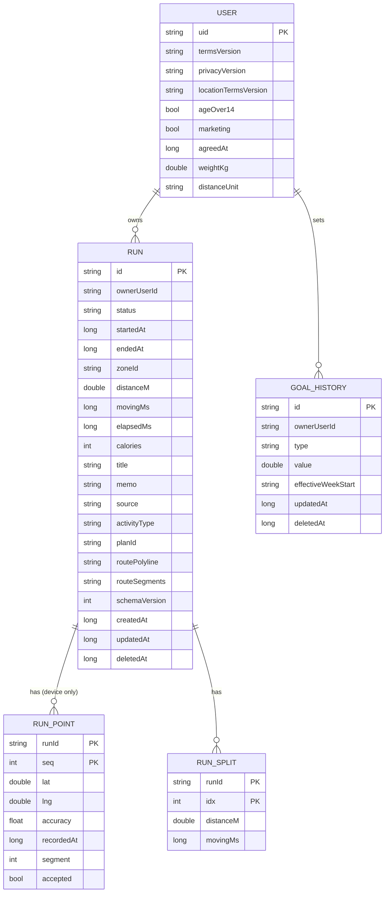

# 데이터 모델 · ERD

## 1. 설계 원칙

| 원칙 | 내용 | 이유 |
|---|---|---|
| ID | 기기에서 생성한 **UUID 문자열**. 자동 증가 숫자 금지 (예외: `run_point`의 `seq`) | Room · Firestore · 이후 자체 서버에서 같은 ID 사용 |
| 날짜 | `yyyy-MM-dd` 문자열 (LocalDate) | 주 시작일 같은 "날짜" 값 |
| 시각 | epoch millis (Long) + 기록에는 시간대 ID(`zone_id`) | 다른 시간대에서 복원해도 "그 기록이 무슨 요일이었는지"를 유지 |
| 거리 · 시간 단위 | 미터(Double) · 밀리초(Long). km · mile 변환은 표시할 때만 | 단위 설정 변경이 데이터에 영향 없음 |
| 삭제 | soft delete (`deleted_at`) | 다른 기기에 삭제 전달. 실제 삭제는 회원 탈퇴와 버린 기록 정리뿐 |
| 열거형 | 대문자 문자열 (`FINISHED`, `OUTDOOR_RUN`) | 숫자 코드보다 서버 이전 시 안전 |
| 원시 점은 기기에만 | `run_point`는 백업하지 않음 | 용량 · 쓰기 한도 · 개인 위치 보호 |
| 미래용 필드 | `source`, `activity_type`, `plan_id`, `schema_version`을 v1부터 | v2 기능에서 마이그레이션 없이 확장 (`roadmap.md` 6장) |
| 동기화 메타 | `sync_state`, 커서는 Room에만 | 서버 스키마를 오염시키지 않음 |

## 2. 논리 ERD



## 3. 저장소별 배치

| 엔티티 | Room | Firestore | 비고 |
|---|---|---|---|
| RUN | `run` | `users/{uid}/runs/{runId}` (로그인 + 백업 켬일 때) | 스플릿은 문서 안 배열로 함께 |
| RUN_SPLIT | `run_split` | RUN 문서의 `splits` 배열 | |
| RUN_POINT | `run_point` | ✗ | 기기에만. 서버엔 단순화 경로(`routePolyline`) |
| GOAL_HISTORY | `goal_history` | `users/{uid}/goals/{goalId}` | 지난 주 달성 계산용 |
| 체중 · 거리 단위 | DataStore (`UserPrefsDataStore`) | `users/{uid}`의 `weightKg` · `distanceUnit` | |
| 약관 동의 | DataStore (`UserPrefsDataStore`) | `users/{uid}`의 동의 필드 | 게스트 동의도 로그인 시 올림 |
| 러닝 설정 (음성 · 자동 일시정지 · 카운트다운 · 화면 켜짐), 배터리 안내 표시 여부 | DataStore (`RunPrefsDataStore`) | ✗ | 기기별 설정 |
| 테마 · 모드, 온보딩 완료 | DataStore (`AppPrefsDataStore`) | ✗ | |

### Room에만 있는 컬럼 · 테이블

| 대상 | 추가 컬럼 / 테이블 |
|---|---|
| `run` | `sync_state` (`LOCAL` 게스트 · `PENDING` · `SYNCED` · `FAILED`), `pause_count`. 진행 중 버퍼 · 페이스 창 같은 추적용 값은 테이블에 두지 않고 `TrackingEngine` 메모리에 |
| `goal_history` | `sync_state` |
| `sync_cursor` | `key` (`runs:{uid}`, `goals:{uid}`), `last_pulled_at_micros` (Firestore 서버 시각 마이크로초. 밀리초로 자르면 같은 문서를 매번 다시 읽음) |

## 4. Firestore 저장 구조

```
users/{uid}
  termsVersion, privacyVersion, locationTermsVersion, ageOver14, marketing, agreedAt,
  marketingUpdatedAt,
  weightKg (없으면 null), distanceUnit ("KM" | "MILE"), profileUpdatedAt,
  updatedAt, serverUpdatedAt

users/{uid}/runs/{runId}
  id, schemaVersion (1),
  status ("FINISHED"),                       // 서버에는 끝난 기록만 올린다
  startedAt, endedAt, zoneId ("Asia/Seoul"),
  distanceM, movingMs, elapsedMs, calories (null 가능),
  splits: [ { distanceM, movingMs }, ... ]   // 최대 200개
  routePolyline (Encoded Polyline, 최대 20,000자), routeSegments: [int, ...],
  title (40자), memo (500자),
  source ("GPS"), activityType ("OUTDOOR_RUN"), planId (null),
  createdAt, updatedAt, deletedAt (null | epoch millis),
  serverUpdatedAt (request.time)

users/{uid}/goals/{goalId}
  id, type ("DISTANCE" | "COUNT"), value, effectiveWeekStart ("2026-10-26"),
  createdAt, updatedAt, deletedAt, serverUpdatedAt
```

- 원시 점, 진행 중(`ACTIVE` · `PAUSED`) 기록, 버린 기록은 올리지 않습니다.
- 보안 규칙의 허용 필드 · 길이 제한은 `firebase/CLAUDE.md`.

## 5. 백업 · 복원 흐름

데이즈의 커플 동기화보다 단순합니다. **한 사람이 자기 기록을 백업**하는 것이라 실시간 리스너를 쓰지 않습니다 (읽기 절약).

### Push (기기 → 서버)

```
기록 저장 · 편집 · 삭제, 목표 변경 (로그인 + 자동 백업 켬)
  → Room에 sync_state = PENDING
  → BackupPushWorker (고유 작업, 5초 디바운스, 네트워크 연결 조건, 지수 백오프)
  → PENDING 행을 최대 20개씩 batch write (serverUpdatedAt = serverTimestamp)
  → 성공: SYNCED / 규칙 거부: FAILED (재시도하지 않고 Crashlytics 기록)
```

### Pull (서버 → 기기)

| 계기 | 동작 |
|---|---|
| 로그인 직후 | 커서 없음 → 전체를 페이지(50개)로 읽어 합침 |
| 앱 시작 (마지막 Pull 후 24시간 지남) | `serverUpdatedAt > 커서`만 읽음 (보통 0~몇 개) |
| M6 "백업에서 복원하기" | 위와 같음 (커서 기준) |

- 합치기: 같은 id면 `updatedAt`이 큰 쪽을 남깁니다. 서버 쪽이 `deletedAt`이면 기기에서도 soft delete.
- 기기에서 고친 PENDING 행은 Pull로 덮어쓰지 않습니다 (Push 후 다시 맞춰짐).
- 복원된 기록은 `run_point`가 없으므로 상세의 경로 · 썸네일 · 공유 카드는 `route_polyline`으로, 페이스 그래프는 스플릿으로 그립니다.

### 게스트 → 로그인

```
로그인 성공 → owner_user_id IS NULL 인 기록 수 확인
  ├─ 0개 → Pull만
  └─ N개 → "이 기기의 기록 N개를 계정에 백업할까요?" (기본: 백업)
        ├─ 백업 → owner_user_id = uid, sync_state = PENDING → Push → Pull
        └─ 나중에 → 게스트 기록으로 남김 (내 정보 > 데이터 · 백업에서 다시 선택 가능)
```

### 로그아웃 · 탈퇴

- 로그아웃: 기기 데이터 유지. 화면 · 통계 · 위젯은 `owner_user_id = 현재 uid` (게스트면 `IS NULL`)만 봅니다. PENDING이 남아 있으면 "아직 백업되지 않은 기록 N개가 있어요"를 먼저 알립니다.
- 회원 탈퇴: 재인증 → `users/{uid}/runs` · `goals`를 50개씩 조회해 batch delete → `users/{uid}` 삭제 → Firebase Auth 계정 삭제 → (선택) 기기의 이 계정 기록 삭제.

## 6. Room Entity 예시

```kotlin
@Entity(
    tableName = "run",
    indices = [
        Index(value = ["owner_user_id", "started_at"]),
        Index("status"),
        Index("sync_state"),
    ],
)
data class RunEntity(
    @PrimaryKey val id: String,                                        // UUID
    @ColumnInfo(name = "owner_user_id") val ownerUserId: String?,      // null = 게스트
    val status: String,                                                // ACTIVE | PAUSED | FINISHED | DISCARDED
    @ColumnInfo(name = "started_at") val startedAt: Long,
    @ColumnInfo(name = "ended_at") val endedAt: Long?,
    @ColumnInfo(name = "zone_id") val zoneId: String,
    @ColumnInfo(name = "distance_m") val distanceM: Double,
    @ColumnInfo(name = "moving_ms") val movingMs: Long,
    @ColumnInfo(name = "elapsed_ms") val elapsedMs: Long,
    val calories: Int?,
    val title: String?,
    val memo: String?,
    val source: String,                                                // GPS
    @ColumnInfo(name = "activity_type") val activityType: String,      // OUTDOOR_RUN
    @ColumnInfo(name = "plan_id") val planId: String?,
    @ColumnInfo(name = "route_polyline") val routePolyline: String?,
    @ColumnInfo(name = "route_segments") val routeSegments: String?,   // JSON 배열 "[312,140]"
    @ColumnInfo(name = "pause_count") val pauseCount: Int,
    @ColumnInfo(name = "schema_version") val schemaVersion: Int,
    @ColumnInfo(name = "created_at") val createdAt: Long,
    @ColumnInfo(name = "updated_at") val updatedAt: Long,
    @ColumnInfo(name = "deleted_at") val deletedAt: Long?,
    @ColumnInfo(name = "sync_state") val syncState: String,            // LOCAL | PENDING | SYNCED | FAILED
)

@Entity(
    tableName = "run_point",
    primaryKeys = ["run_id", "seq"],
    foreignKeys = [ForeignKey(RunEntity::class, ["id"], ["run_id"], onDelete = ForeignKey.CASCADE)],
)
data class RunPointEntity(
    @ColumnInfo(name = "run_id") val runId: String,
    val seq: Int,
    val lat: Double,
    val lng: Double,
    val altitude: Double?,
    val accuracy: Float,
    val speed: Float?,
    @ColumnInfo(name = "recorded_at") val recordedAt: Long,
    val segment: Int,
    val accepted: Boolean,
)
```

- 통계(R2 · H1 · 위젯)는 `run`의 `distance_m` · `moving_ms` 합계 쿼리로 계산합니다. `run_point`를 읽지 않습니다.
- 주 경계는 기록의 `zone_id`로 `started_at`을 LocalDate로 바꿔 판단합니다 (`core:domain` `WeeklyProgress`).

## 7. 용량 · 한도 추정 (Spark)

| 항목 | 추정 |
|---|---|
| 기록 문서 1개 | 요약 ~0.5KB + polyline ~3.5KB + 색인 오버헤드 → **약 4.5KB** |
| 1GiB 저장 한도 | 약 23만 개 기록 (예: 사용자 2,300명 × 100개) |
| 사용자 1명 · 하루 | 쓰기 1~3 (저장 · 메모 · 백업 재시도), 읽기 1~2 (24시간 Pull, 결과가 0개여도 1회 집계) |
| 하루 쓰기 한도 2만 | 하루 러닝하는 사용자 약 6,000명까지 |
| 복원 1회 | 기록 수만큼 읽기 (300개면 300) |

저장 용량이 가장 먼저 닿는 한도입니다. 50%(0.5GiB)에 닿으면 `infra-and-billing-protection.md` 7장의 대응(polyline 상한 축소, 오래된 기록 경로 압축, 요금제 재검토)을 시작합니다.
